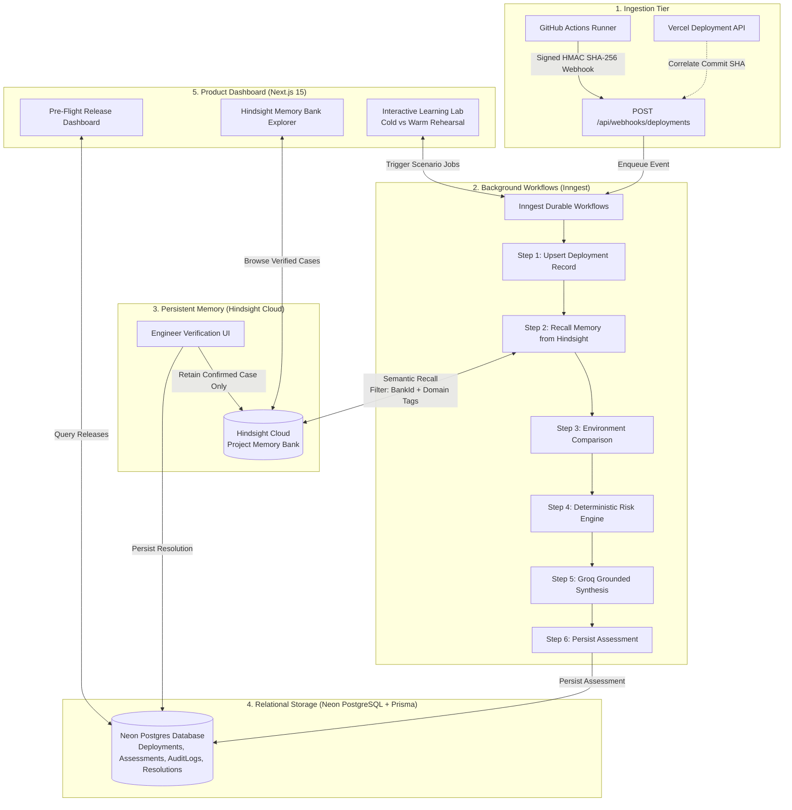
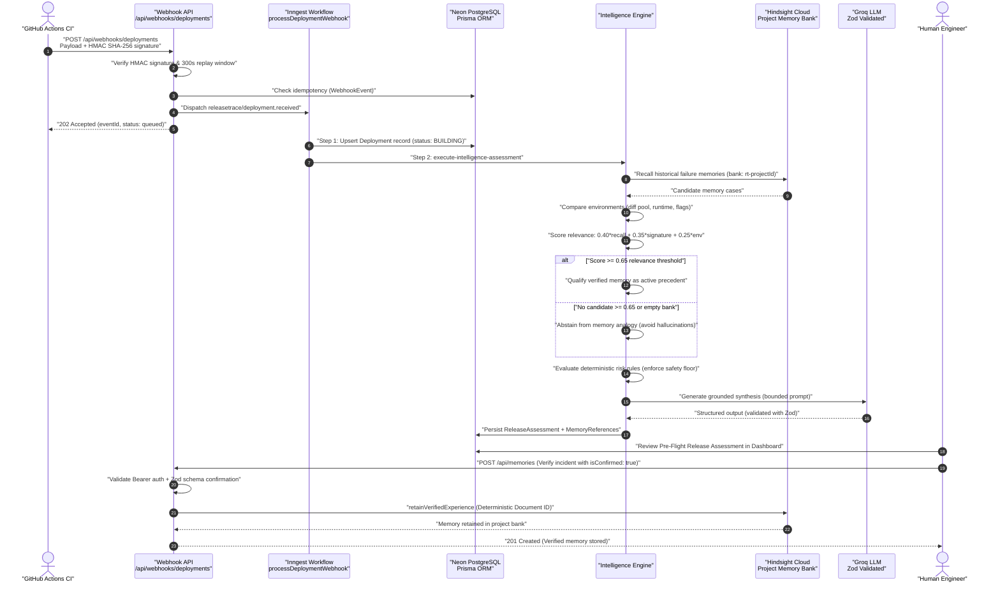

# ReleaseTrace — Persistent-Memory Release Intelligence Agent

> **"Hindsight memory informs. Current evidence verifies. The engineer decides."**

[](https://www.typescriptlang.org/)
[](https://nextjs.org/)
[](https://vectorize.io)
[](https://www.prisma.io/)
[](https://neon.tech/)
[](https://www.inngest.com/)
[](https://groq.com/)
[](https://app.band.ai)
[](https://vitest.dev/)

---

## Key Links

- **Live Application Dashboard:** [https://release-trace-red.vercel.app/dashboard](https://release-trace-red.vercel.app/dashboard)
- **Technical Deep-Dive Article:** [Every Release Leaves a Trace: Teaching a Deployment Pipeline to Remember](https://dev.to/amritesh_mishra_f93bc6ac3/every-release-leaves-a-trace-teaching-a-deployment-pipeline-to-remember-59jl)
- **Demo Video:** <!-- add YouTube link -->

---

## 1. Overview & Problem

Modern CI/CD pipelines evaluate every pull request and release in isolation. Monitoring tools catch runtime errors after code is deployed, while post-mortems and runbooks sit in wikis disconnected from deployment automation. When recurring failure patterns occur—such as database connection pool exhaustion during migrations or unindexed table locks under high write loads—pipelines repeat known historical mistakes. ReleaseTrace solves this by establishing an immutable, project-scoped memory bank that connects past verified failure resolutions directly to release pre-flight checks.

### What ReleaseTrace Does

1. **Ingests signed release telemetry:** Receives commit SHA, branch, test outcomes, build artifacts, and Prisma migration state through HMAC-SHA256 authenticated webhooks.
2. **Recalls project memory:** Queries Hindsight Cloud to recall relevant past failure incidents and verified post-mortems for the project.
3. **Compares target environments:** Performs a deterministic diff of runtime versions, database pool sizes, PgBouncer pooling modes, and configuration flags between historical incidents and the incoming release.
4. **Scores relevance and enforces abstention:** Evaluates a composite score across semantic retrieval, failure signature similarity, and environment match; strictly abstains from historical analogies when recall is weak or the memory bank is empty.
5. **Evaluates deterministic risk rules:** Applies immutable release-risk rules (e.g. migration pool exhaustion, unindexed schema changes) to establish an immutable safety floor.
6. **Synthesizes grounded explanations:** Uses Groq LLM to generate context-rich explanations validated against strict Zod schemas, with safety floors preventing downgrades of critical/high risks.
7. **Enforces human confirmation:** Requires an authorized engineer to confirm root cause and mitigation before retaining verified resolutions into Hindsight.

---

## 2. How Hindsight Memory is Used

### What is Retained
Structured units of verified engineering experience (`DeploymentMemoryCase` / `VerifiedEngineeringMemory` defined in [`src/intelligence/memory/schema.ts`](src/intelligence/memory/schema.ts)). Each retained record includes:
- **Failure Context:** Incident title, affected service, failure category, confirmed root cause, error signatures, and affected components.
- **Environment Snapshot:** Node.js runtime version, PostgreSQL engine version, connection pool limits, PgBouncer pooling mode, and environment flags active during the failure.
- **Mitigation & Checklist:** Concrete prevention steps, verification dates, and an actionable deployment pre-flight checklist.
- **Attribution & Confirmation:** Explicit confirmation metadata (`isConfirmed: true`, `confirmedBy`, `confirmationTimestamp`, `notes`).

### What is Recalled
During release evaluation, `HistoricalRecallWorkflow.recallHistoricalFailures` ([`src/intelligence/hindsight/recall.ts`](src/intelligence/hindsight/recall.ts)) queries the project-scoped memory bank (`rt-${projectId}`) in Hindsight Cloud. It performs semantic vector retrieval filtered by domain tags to return candidate past incidents matching the incoming release's service name and deployment evidence.

### Relevance Scoring
Memories are evaluated by `evaluateMemoryRelevance` and `calculateSignatureSimilarity` ([`src/intelligence/memory/relevance.ts`](src/intelligence/memory/relevance.ts)) using a three-part composite heuristic:

$$\text{Final Relevance Score} = (0.40 \times \text{Hindsight Score}) + (0.35 \times \text{Signature Similarity}) + (0.25 \times \text{Environment Match})$$

- **Hindsight Retrieval Score (40%):** Raw vector retrieval score (0.0 to 1.0) from Hindsight Cloud.
- **Failure Signature Similarity (35%):** Domain-specific heuristic checking service alignment, database migration involvement, and keyword matches between historical error signatures and git diffs/file lists.
- **Environment Match Score (25%):** Calculated by `compareEnvironments` ([`src/intelligence/memory/environment-comparator.ts`](src/intelligence/memory/environment-comparator.ts)), assessing runtime version compatibility, database engine consistency, and connection pool sizing.
- **Relevance Threshold (0.65):** Candidates scoring below `0.65` (`DEFAULT_RELEVANCE_THRESHOLD`) are disqualified to avoid drawing weak analogies.

### The Abstention Path
ReleaseTrace enforces strict abstention via `evaluateRecallRelevance` ([`src/intelligence/memory/relevance.ts`](src/intelligence/memory/relevance.ts)):
- **Empty Memory Bank (`ABSTAINED_NO_RELEVANT_MEMORIES`):** When no historical memories exist in the project bank, ReleaseTrace explicitly reports that no prior incident history is available.
- **Weak Recall (`ABSTAINED_WEAK_RECALL`):** When candidate memories exist but all score below 0.65, ReleaseTrace flags weak recall and abstains from citing historical precedents.

In both abstention states, the intelligence engine falls back strictly to current deployment evidence and baseline deterministic rules. It never hallucinates past incidents.

### The Human Confirmation Gate
Implemented in [`src/app/api/memories/route.ts`](src/app/api/memories/route.ts) and [`src/intelligence/memory/schema.ts`](src/intelligence/memory/schema.ts) (`assertEngineerConfirmation`):
- Speculative LLM suggestions or unconfirmed hypotheses are rejected (`403 Forbidden` if `isConfirmed !== true`).
- Writes to production memory banks require Bearer token authorization (`RELEASETRACE_AUTH_SECRET`).
- Unauthenticated requests are restricted to an isolated demo project bank (`demo-${projectId}`) to prevent polluting production memory.
- Validated records are written idempotently using deterministic document IDs via `ExperienceRetentionWorkflow.retainVerifiedExperience` ([`src/intelligence/hindsight/retention.ts`](src/intelligence/hindsight/retention.ts)).

---

## 3. Architecture

### System Flowchart



#### Flowchart Walkthrough
1. **Ingestion Tier:** GitHub Actions dispatches deployment metadata (commit, branch, test results, Prisma migration artifacts) signed with timing-safe HMAC-SHA256 signatures to `/api/webhooks/deployments`. The webhook verifies the signature, enforces a 300-second timestamp freshness window, checks idempotency in Neon PostgreSQL, and correlates Vercel deployments by commit SHA.
2. **Orchestration Tier:** Inngest executes the durable workflow `processDeploymentWebhook`. It upserts deployment records in Neon PostgreSQL, triggers the intelligence engine, and persists assessment outputs.
3. **Memory Tier:** Hindsight Cloud stores project-isolated semantic memory banks. Candidate failure memories are recalled during pre-flight checks, and verified incident resolutions are retained only when an engineer confirms root cause and mitigation.
4. **Relational Storage:** Neon PostgreSQL (queried via Prisma ORM) maintains queryable operational records for projects, deployments, risk assessments, webhook audit trails, and human resolutions.
5. **Product Dashboard:** Next.js 15 App Router serves pre-flight release dashboards, the Hindsight memory explorer, and the interactive learning lab.

---

### Single Release Journey



#### Sequence Walkthrough
1. **Webhook Ingestion:** GitHub Actions posts release evidence signed with HMAC-SHA256. The API verifies the cryptographic signature, ensures timestamp drift is within 300 seconds, and logs the event idempotently.
2. **Durable Orchestration:** The webhook queues `releasetrace/deployment.received` in Inngest, which initiates `processDeploymentWebhook`.
3. **Memory Retrieval & Scoring:** The intelligence engine queries Hindsight Cloud for past incidents. It compares environments and scores each candidate against the composite relevance formula.
4. **Abstention or Qualification:** Candidates meeting the 0.65 threshold are qualified as active precedents; otherwise, the engine abstains from historical claims.
5. **Deterministic Rules & LLM Synthesis:** Deterministic rules establish a baseline risk level (e.g. `CRITICAL` or `HIGH`). Groq synthesizes a structured explanation that cannot lower this deterministic safety floor.
6. **Persistence & Engineer Decision:** The assessment is stored in Neon PostgreSQL for review in the dashboard.
7. **Human Confirmation & Retention:** When an incident is investigated and resolved, an engineer submits a confirmation (`isConfirmed: true`) with Bearer authentication to `/api/memories`. The resolution is committed to Hindsight Cloud.

---

## 4. Tech Stack

| Layer | Technology | Purpose in ReleaseTrace |
| :--- | :--- | :--- |
| **Framework** | Next.js 15 (App Router, React 19) | Application dashboard, telemetry views, and REST API endpoints |
| **ORM** | Prisma 6 (`@prisma/client`, `@prisma/adapter-neon`) | Typed database models, schema migrations, and queries |
| **Database** | Neon PostgreSQL (Serverless) | Relational storage for projects, webhook events, deployments, assessments, and audit logs |
| **Durable Workflows** | Inngest (`inngest`) | Step-based, retryable asynchronous background execution for webhook processing |
| **LLM Provider** | Groq (`groq-sdk`, model `openai/gpt-oss-120b`) | Fast structured assessment synthesis and plain-English engineering explanations |
| **Semantic Memory** | Hindsight Cloud (`@vectorize-io/hindsight-client`) | Project-isolated persistent memory banks for verified engineering experience recall and retention |
| **Contract Validation** | Zod 3 (`zod`) | Runtime schema validation for webhook payloads, intelligence contracts, and LLM structured output |
| **Unit & Integration Tests** | Vitest 3 (`vitest`) | Unit test runner and assertion library (101 tests across 21 suites) |
| **E2E Testing** | Playwright (`@playwright/test`) | End-to-end browser testing for dashboard, deployment register, and memory explorer flows |
| **Agent Integration** | Band AI SDK (`@band-ai/sdk`) | Persistent WebSocket connection enabling ReleaseTrace AI to participate in Band team rooms |

---

## 5. Getting Started

### Prerequisites
- Node.js `v22.x` or higher
- npm `v10.x` or higher

### Installation
Clone the repository and install dependencies:
```bash
npm install --legacy-peer-deps
```

### Environment Configuration
Copy the configuration template:
```bash
cp .env.example .env
```

Configure your credentials in `.env`. Note: `.env.example` contains placeholder values only. Never commit real credentials to version control.

Key variables:
- `DATABASE_URL`: Neon PostgreSQL pooled connection string (`?sslmode=require&pgbouncer=true`).
- `DIRECT_URL`: Neon PostgreSQL direct connection string for Prisma migrations.
- `HINDSIGHT_BASE_URL` & `HINDSIGHT_API_KEY`: Hindsight Cloud API credentials.
- `GROQ_API_KEY`: Groq API key for structured synthesis.
- `RELEASETRACE_WEBHOOK_SECRET`: Shared secret for HMAC-SHA256 webhook signature validation.
- `RELEASETRACE_AUTH_SECRET`: Shared secret for authorized memory retention to production banks.
- `BAND_AGENT_ID` & `BAND_API_KEY`: Band platform credentials for the standalone agent worker.

### Database Setup
Generate the Prisma client and push the schema to Neon:
```bash
npm run db:generate
npm run db:push
```

### Running the Application
Start the Next.js development server:
```bash
npm run dev
```
Open [http://localhost:3000](http://localhost:3000) to view the dashboard.

### Running the Standalone Band AI Agent Worker
To connect ReleaseTrace AI as a persistent participant in Band rooms:
```bash
npm run band:agent
```

### Testing Commands
Every command is configured in `package.json`:
- **Run test suite (Vitest):** `npm test`
- **Run tests in watch mode:** `npm run test:watch`
- **Run test coverage:** `npm run test:coverage`
- **TypeScript type check:** `npx tsc --noEmit`
- **Code linting:** `npm run lint`
- **Production build check:** `npm run build`
- **Hindsight Cloud smoke test:** `npm run smoke:hindsight`
- **Reproducible demo rehearsal:** `npm run rehearse` (or `npm run demo`)
- **End-to-end browser tests:** `npm run test:e2e`

---

## 6. Project Structure

```
Devnovate/
├── prisma/
│   ├── schema.prisma              # Neon PostgreSQL data models (Projects, Deployments, Assessments)
│   └── migrations/                # Historical migration records
├── src/
│   ├── app/                       # Next.js 15 App Router (dashboard, deployments, memories, APIs)
│   │   ├── api/
│   │   │   ├── assess/            # Direct assessment evaluation API
│   │   │   ├── dashboard/         # Aggregated operational stats API
│   │   │   ├── deployments/       # Deployment register & detail APIs
│   │   │   ├── inngest/           # Inngest webhook route
│   │   │   ├── memories/          # Hindsight memory retrieval & retention API
│   │   │   └── webhooks/          # Signed deployment webhook ingestion endpoint
│   │   ├── dashboard/             # Pre-flight release dashboard
│   │   ├── deployments/           # Deployment register and detail views
│   │   ├── learning-lab/          # Cold vs warm rehearsal scenarios
│   │   └── memories/              # Hindsight Memory Bank Explorer
│   ├── band-agent/                # Standalone Band AI agent worker (@band-ai/sdk)
│   ├── contracts/                 # Frozen TypeScript and Zod data contracts
│   ├── intelligence/              # Core intelligence and memory engine
│   │   ├── engine/                # Assessment coordination and safety floor enforcement
│   │   ├── hindsight/             # Hindsight Cloud client adapter, recall, and retention
│   │   ├── llm/                   # Groq adapter and structured output schemas
│   │   ├── memory/                # Relevance scoring, environment comparator, contradiction detector
│   │   └── rules/                 # Deterministic release-risk rules
│   └── lib/                       # Database client, security helpers, Inngest client, Vercel client
├── tests/                         # Automated test suites (101 unit and integration tests)
├── docs/                          # Architecture, system design, data flow, and Band integration docs
└── scripts/                       # Metadata collection, smoke tests, and rehearsal runners
```

---

## 7. Development Workflow

ReleaseTrace was built with **Band Desktop** for agent-assisted development, leveraging multi-agent collaboration across architecture planning, security auditing, memory contract design, and platform integration.

For complete documentation on running ReleaseTrace AI as a persistent team member in Band collaborative workspaces, see the [Band Platform Integration Guide](docs/BAND_INTEGRATION.md).

---

## 8. Testing & Known Limitations

### Test Coverage
- **101 tests passing across 21 test suites** in Vitest.
- Tests cover HMAC-SHA256 signature verification, replay protection boundaries, Zod contract validation, environment comparison diffing, composite relevance scoring, abstention triggers, contradiction detection, deterministic rule floors, and memory retention authorization.

### Live Functionality vs. Sandbox Fixtures
- **Live Functionality:**
  - Ingestion webhook HMAC verification, timestamp freshness checks, and database deduplication.
  - Relational persistence in Neon PostgreSQL via Prisma ORM.
  - Durable Inngest background workflow execution (`processDeploymentWebhook`).
  - Hindsight Cloud client adapter for live semantic recall and retention.
  - Groq LLM adapter with Zod structured output validation and deterministic safety floor enforcement.
  - Human confirmation gate requiring Bearer authorization for production bank writes.
  - Standalone Band AI agent worker connecting via persistent WebSocket.
- **Sandbox Fixtures & Simulated Telemetry:**
  - **Learning Lab (`/learning-lab`):** Uses curated rehearsal scenarios (e.g. cold memory vs. warm recalled incident) to demonstrate pipeline memory evolution interactively without requiring production downtime.
  - **Offline Fallbacks:** When `HINDSIGHT_API_KEY` or `GROQ_API_KEY` are not set, mock adapters activate automatically to allow local offline evaluation without errors.
  - **Vercel Correlation:** Correlates deployments by commit SHA when `VERCEL_API_TOKEN` is configured; gracefully operates using webhook evidence alone if Vercel tokens are omitted.

---

## 9. License

This project is licensed under the [MIT License](LICENSE).
