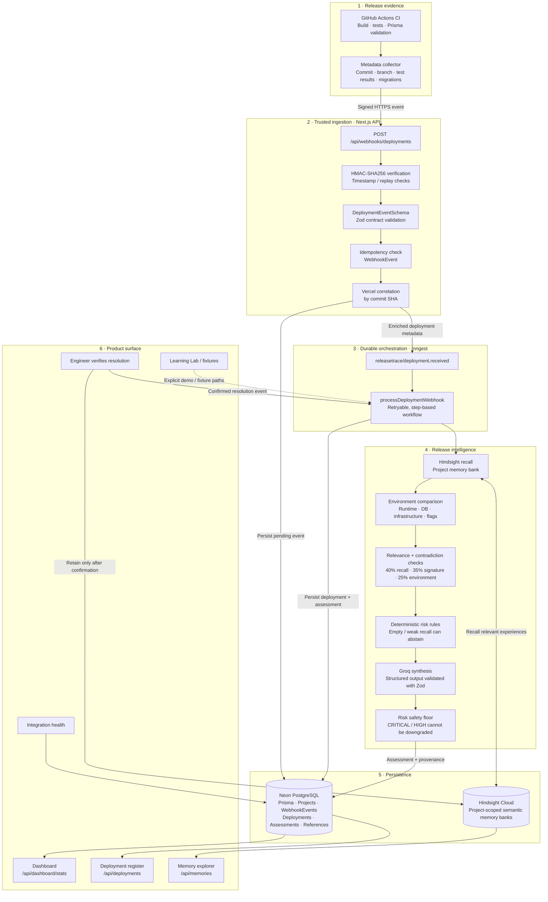
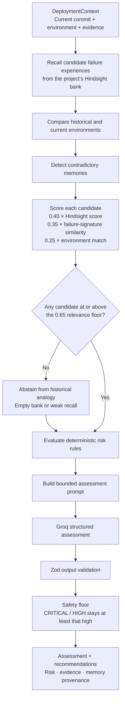
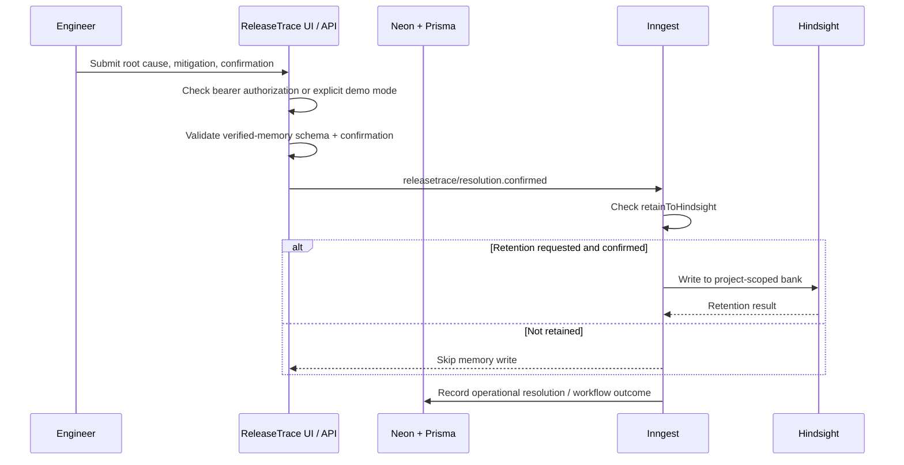

# ReleaseTrace — System Architecture

> **Hindsight memory informs. Current evidence verifies. The engineer decides.**

ReleaseTrace is a release-intelligence system for deployment pipelines. It combines signed CI evidence, durable asynchronous processing, deterministic release-risk rules, project-scoped historical memory, and an engineer-facing dashboard. It is not an autonomous deployment controller: it evaluates evidence and recommends an action; the engineer remains responsible for the release decision.

This document follows the implementation in the repository rather than describing a proposed future architecture.

## 1. System at a glance



## 2. Release event lifecycle

### A. CI creates evidence

The GitHub Actions workflow runs the project checks (dependency installation, Prisma validation, ESLint, Vitest, and a production build). The metadata collector packages the commit SHA, branch, build/test outcomes, and available migration evidence. It signs the payload before sending it to ReleaseTrace.

Relevant files:
- `.github/workflows/releasetrace-ci.yml`
- `scripts/collect-deployment-metadata.mjs`
- `src/lib/security/signature.ts`

### B. The webhook validates and queues the event

`POST /api/webhooks/deployments` reads the raw request body and verifies the HMAC signature using the configured webhook secret. It validates the payload against `DeploymentEventSchema`; malformed JSON or invalid evidence is rejected rather than silently completed with invented metadata.

The handler builds an idempotency key from the provider and event ID and records a `WebhookEvent`. It then attempts to correlate the Vercel deployment using the commit SHA and sends `releasetrace/deployment.received` to Inngest. A new event is marked processed only after the Inngest dispatch succeeds; dispatch failure is recorded as recoverable so it can be retried.

Relevant files:
- `src/app/api/webhooks/deployments/route.ts`
- `src/contracts/`
- `src/lib/security/signature.ts`
- `src/lib/vercel/`

### C. Inngest runs the durable workflow

`processDeploymentWebhook` is triggered by `releasetrace/deployment.received` and is configured with retries. It upserts the deployment record, maps the received evidence into a `DeploymentContext`, invokes the intelligence engine, and persists the resulting assessment and its memory references in Neon through Prisma.

The webhook endpoint therefore does not own the full assessment lifecycle. Inngest provides the retryable processing boundary, while PostgreSQL keeps the operational deployment and assessment records.

Relevant files:
- `src/lib/inngest/client.ts`
- `src/lib/inngest/functions.ts`
- `src/app/api/inngest/route.ts`
- `src/lib/db/`
- `prisma/schema.prisma`

## 3. Inside the intelligence engine



The engine in `src/intelligence/engine/intelligence-engine.ts` coordinates these stages:

1. **Recall:** `HistoricalRecallWorkflow` retrieves possible historical failures from the project bank.
2. **Compare:** `compareEnvironments` evaluates relevant runtime, database, infrastructure, and configuration differences.
3. **Check consistency:** contradiction detection identifies conflicting historical accounts.
4. **Qualify or abstain:** `evaluateRecallRelevance` combines semantic retrieval, failure-signature similarity, and environment match. The default floor is **0.65**. An empty bank or a set of weak matches produces an explicit abstention state.
5. **Apply deterministic rules:** `evaluateDeterministicRules` evaluates current evidence and qualified historical context.
6. **Explain:** Groq produces structured recommendations; the output is validated against the project's Zod schema.
7. **Enforce the safety floor:** an LLM response cannot lower a deterministic `HIGH` or `CRITICAL` result.
8. **Preserve provenance:** the assessment records its risk result, evidence summary, memory references, and model provenance.

The relevance weights are an engineering heuristic, not a statistically calibrated probability that a release will fail. A high historical match is not proof that the current release has the same failure.

Relevant files:
- `src/intelligence/engine/intelligence-engine.ts`
- `src/intelligence/hindsight/recall.ts`
- `src/intelligence/memory/environment-comparator.ts`
- `src/intelligence/memory/contradiction-detector.ts`
- `src/intelligence/memory/relevance.ts`
- `src/intelligence/rules/risk-rules.ts`
- `src/intelligence/llm/groq-adapter.ts`
- `src/intelligence/llm/schemas.ts`

## 4. Two stores, two different responsibilities

| Store | What belongs there | Why it exists |
|---|---|---|
| **Neon PostgreSQL + Prisma** | Projects, webhook events, normalized deployments, assessments, memory references, operational metadata | Queryable system of record for current releases and application state |
| **Hindsight Cloud** | Project-scoped semantic records of verified engineering experiences | Recall of relevant historical incidents and their verified resolutions |

Hindsight is not the source of truth for the current deployment. Current evidence and operational records are stored and evaluated independently. The project bank manager derives a bank per project so that one project's incident history is not intended to become another project's context.

### Resolution and memory retention



The memory-retention path validates the structured memory, requires explicit confirmation, assigns a deterministic document identifier for retry safety, and retries transient write failures. Demo-mode records are routed to a separate demo project/bank rather than the canonical production project bank. A bearer token is a shared authorization credential; it should not be presented as proof of a uniquely identified individual engineer.

Relevant files:
- `src/app/api/memories/route.ts`
- `src/intelligence/hindsight/retention.ts`
- `src/intelligence/hindsight/bank-manager.ts`
- `src/intelligence/memory/schema.ts`
- `src/lib/inngest/functions.ts`

## 5. How the application pages obtain information

| Page / surface | Main source or behavior |
|---|---|
| **Dashboard** | Fetches live aggregate counts, latest deployment records, database status, Hindsight status, and registered deterministic rule count from `/api/dashboard/stats`. |
| **Deployments** | Reads the project-scoped, paginated deployment register from `/api/deployments`. |
| **Memory Explorer** | Reads Hindsight through `GET /api/memories`; writes are protected by bearer authorization or isolated explicit demo mode. |
| **Integrations** | Uses the integration-health API to probe configured dependencies. |
| **Learning Lab** | Provides curated learning/rehearsal scenarios; it is a learning surface, not a substitute for a production deployment event. |
| **Settings** | Contains UI policy/configuration controls; not every setting is persisted as server-side configuration. |
| **Deployment detail / simulator** | Some detail and sandbox interactions remain demonstration-oriented and must not be mistaken for a fully wired production control plane. |

The product shell also includes the beginner/DevOps guide, architecture walkthrough, release simulator, and glossary. These help explain the workflow but do not change the authority of the risk engine or allow an AI recommendation to deploy or roll back production automatically.

Relevant files:
- `src/app/dashboard/page.tsx`
- `src/app/api/dashboard/stats/route.ts`
- `src/app/deployments/page.tsx`
- `src/app/api/deployments/route.ts`
- `src/app/memories/page.tsx`
- `src/app/api/memories/route.ts`
- `src/app/integrations/page.tsx`
- `src/app/api/integrations/health/route.ts`
- `src/components/layout/AppLayout.tsx`

## 6. Trust boundaries and operational rules

- **Verify before processing:** signed webhook payloads are checked before they enter the release workflow.
- **Validate contracts:** deployment events and structured model output are schema-validated.
- **Deduplicate:** repeated provider events are tracked by an idempotency key.
- **Separate current facts from memory:** historical Hindsight records inform an assessment; they do not replace current telemetry or deployment evidence.
- **Abstain when evidence is weak:** no relevant history is not a reason to invent an incident.
- **Keep deterministic floors:** the model cannot downgrade a deterministic HIGH or CRITICAL baseline.
- **Require human confirmation for memory:** speculative model output is not an approved engineering precedent.
- **Do not execute production actions autonomously:** ReleaseTrace provides analysis and recommendations; the engineer decides what to do.

## 7. Local verification and integration boundaries

The repository's primary CI workflow runs `npm ci`, `prisma validate`, `npm run lint`, `npm run test`, and `npm run build`. The Playwright suite is separately exposed through `npm run test:e2e`; it is not part of that workflow by default.

A green build or preview deployment proves that the corresponding revision compiled/deployed. It does **not** by itself prove that every live integration is configured, every page is backed by production data, or every user interaction is fully wired. For a production rollout, separately verify the webhook secret, Inngest endpoint, Neon connection, Hindsight credentials/bank, Groq key, and Vercel configuration, then exercise an actual signed event and confirm the persisted deployment, assessment, and permitted memory-retention path.

---

## Repository map

```text
src/
├── app/
│   ├── api/
│   │   ├── assess/                 # Direct assessment endpoint
│   │   ├── dashboard/stats/        # Live dashboard metrics
│   │   ├── deployments/            # Deployment register API
│   │   ├── inngest/                # Inngest serving endpoint
│   │   ├── integrations/health/    # Integration probes
│   │   ├── memories/               # Hindsight recall + verified retention API
│   │   └── webhooks/deployments/   # Signed deployment ingestion
│   └── ...                         # Next.js product pages
├── intelligence/
│   ├── engine/                     # End-to-end risk assessment orchestration
│   ├── hindsight/                  # Adapter, bank, recall, retention
│   ├── memory/                     # Relevance, environment, contradiction, schemas
│   ├── rules/                      # Deterministic risk rules
│   └── llm/                        # Groq prompts, adapter, output schemas
├── lib/
│   ├── db/                         # Prisma / Neon access
│   ├── inngest/                    # Durable event workflows
│   ├── security/                   # Signature verification
│   └── vercel/                     # Deployment correlation
└── components/                     # Product shell and reusable UI
prisma/
└── schema.prisma                   # Relational persistence model
.github/workflows/
└── releasetrace-ci.yml             # CI verification + signed event collection
```
