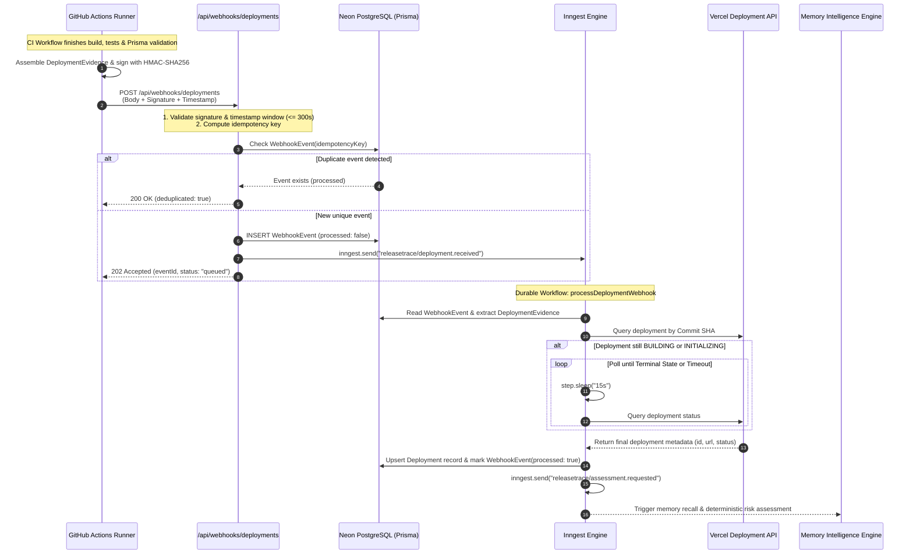
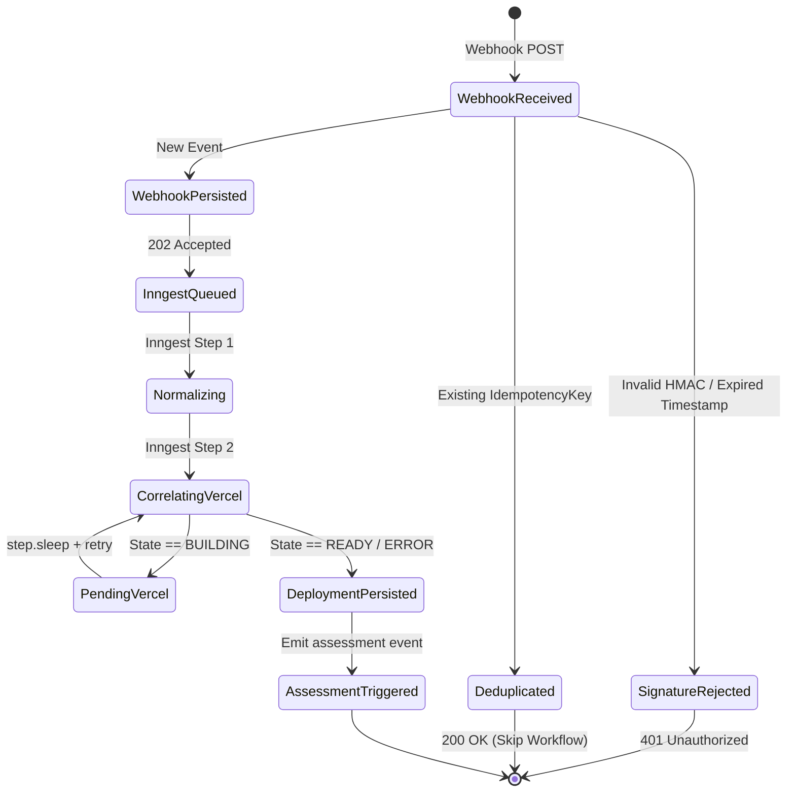

# ReleaseTrace — Data Flow Specification

## 1. End-to-End Release Event Data Flow

This document details the complete end-to-end event progression through the Platform and Integration subsystem of ReleaseTrace.



---

## 2. Ingestion Request & Signature Structure

### 2.1 Request Headers
```http
POST /api/webhooks/deployments HTTP/1.1
Host: releasetrace.domain
Content-Type: application/json
X-ReleaseTrace-Signature: sha256=4f53cda18c2baa0c0354bb5f9a3ecbe5ed12ab4d8e11ba873c2f11161202b945
X-ReleaseTrace-Timestamp: 2026-11-06T21:40:00.000Z
X-ReleaseTrace-Event-Id: evt_gh_123456789
```

### 2.2 Payload Structure (Frozen `DeploymentEventSchema`)
```json
{
  "eventId": "evt_gh_123456789",
  "provider": "github_actions",
  "projectId": "proj_releasetrace_core",
  "projectName": "ReleaseTrace Core",
  "eventType": "deployment_completed",
  "timestamp": "2026-11-06T21:40:00.000Z",
  "evidence": {
    "commitSha": "a1b2c3d4e5f67890",
    "branch": "main",
    "commitMessage": "feat(db): add user audit table",
    "author": "amrit-verse",
    "repository": "amrit-verse/releasetrace",
    "framework": "nextjs",
    "runtimeVersion": "nodejs-22",
    "buildPassed": true,
    "testsPassed": true,
    "testSummary": {
      "total": 42,
      "passed": 42,
      "failed": 0,
      "skipped": 0
    },
    "migrationEvidence": {
      "hasPendingMigrations": false,
      "migrationFileCount": 3,
      "migrationNames": ["20261106_init", "20261106_add_deployments", "20261106_add_audit"],
      "appliedMigrationsCount": 3,
      "schemaHash": "sha256:7c9e1...",
      "validationError": null
    },
    "changedFiles": ["prisma/schema.prisma", "src/lib/db/client.ts"],
    "environment": "production",
    "collectedAt": "2026-11-06T21:39:55.000Z"
  },
  "metadata": {
    "githubRunId": "1198273645",
    "githubRunAttempt": "1"
  }
}
```

---

## 3. Database State Transition Model


