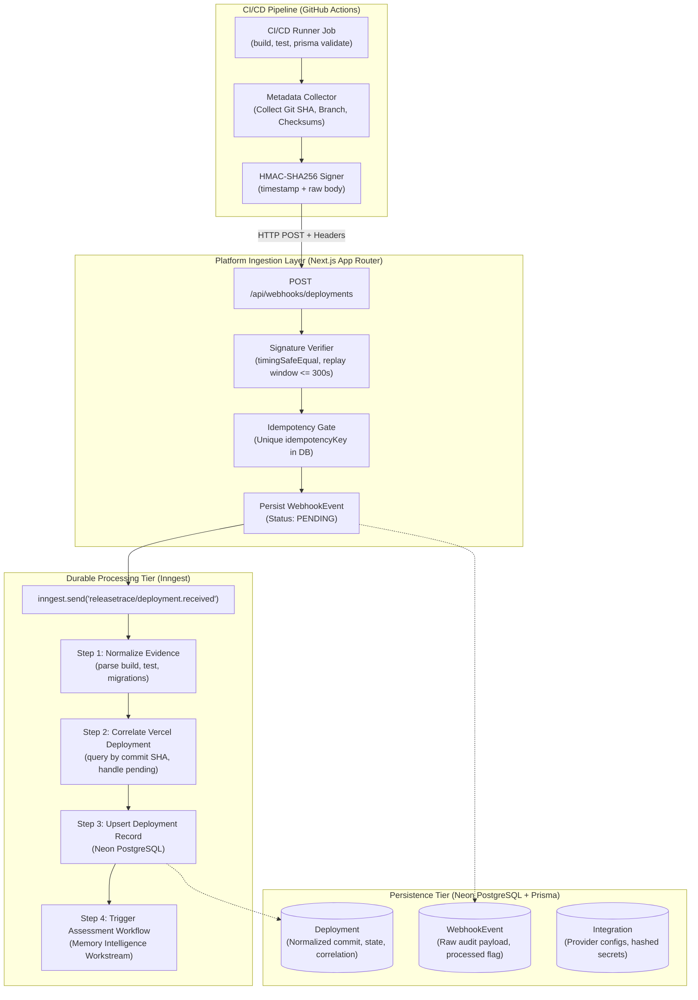

# ReleaseTrace — System Design Specification

## 1. System Overview

ReleaseTrace is a persistent-memory DevOps release intelligence platform designed to eliminate recurrent deployment incidents in modern web applications (specifically Next.js on Vercel with PostgreSQL/Prisma).

The Platform & Integration subsystem is responsible for:
1. **Signed Ingestion**: Receiving deployment and CI/CD lifecycle events from GitHub Actions and Vercel webhooks via timestamped HMAC-SHA256.
2. **Event Verification & Deduplication**: Cryptographically authenticating raw payloads, enforcing replay prevention windows, and idempotently recording events.
3. **External Deployment Correlation**: Interfacing with the Vercel REST API to query deployment statuses by Git commit SHA and handle asynchronous pending states.
4. **Durable Orchestration**: Executing resilient, step-memoized background workflows via Inngest without blocking webhook handlers.
5. **Relational Persistence**: Normalizing deployment facts, environment metrics, and event histories using Neon PostgreSQL and Prisma ORM with the Neon serverless adapter.

---

## 2. Platform Architecture

---

## 3. Security Model

### 3.1 HMAC-SHA256 Ingestion Verification
- **Header Protocol**:
  - `X-ReleaseTrace-Signature`: Formatted as `sha256=<hex_digest>`.
  - `X-ReleaseTrace-Timestamp`: ISO 8601 or UNIX epoch milliseconds string when the payload was signed.
- **Payload Integrity**: The HMAC signature is generated across `${timestamp}.${raw_payload_string}` using the project's shared secret.
- **Timing Attacks**: Server-side verification uses `crypto.timingSafeEqual` with byte buffers to prevent timing side-channel attacks.
- **Anti-Replay Window**: Signatures older than 300 seconds (5 minutes) or timestamps skewed into the future by more than 60 seconds are rejected with `401 Unauthorized`.
- **Secret Zero-Exposure**: Raw integration secrets and webhook secrets are never stored in plaintext columns. In production, webhook secret hashes (`webhookSecretHash`) are stored using SHA-256 digests or encrypted configuration blobs. Secrets are never logged in application or debug output.

### 3.2 Idempotency and Deduplication
- Each ingestion event calculates a deterministic idempotency key:
  `idempotencyKey = sha256(projectId + ":" + provider + ":" + eventId)`
- Database constraint: `WebhookEvent(idempotencyKey)` has a `@unique` index.
- If an event arrives with an existing `idempotencyKey`:
  - If previously processed, the ingestion handler immediately returns HTTP 200/202 with `{ deduplicated: true, status: "already_processed" }` without re-queuing the Inngest workflow.
  - If previously failed, it allows controlled retry based on workflow policy.

---

## 4. Vercel Deployment Correlation

### 4.1 Commit SHA Correlation
When GitHub Actions notifies ReleaseTrace of a build completion, the Vercel deployment may still be provisioning or building.
The Vercel integration client (`VercelClient`):
1. Calls `GET https://api.vercel.com/v6/deployments?projectId={vercelProjectId}&meta-githubCommitSha={commitSha}` or lists project deployments filtered by Git commit metadata.
2. Correlates the deployment by commit SHA.
3. If no deployment is found or the deployment is in state `BUILDING` or `INITIALIZING`:
   - The Inngest step executes an exponential backoff / retry step (`step.sleep` or step retry) up to a configurable deadline (e.g. 5 attempts over 2 minutes).
   - Once resolved (`READY` or `ERROR`), normalizes the Vercel deployment ID, target URL, and final state into the database record.

### 4.2 Error Handling & Resilience
- Handles Vercel rate limits (`429 Too Many Requests`) honoring `Retry-After`.
- Handles network timeouts and invalid tokens gracefully without exposing bearer credentials.
- In environments without real Vercel credentials, the integration provides a mock-capable interface and deterministic test harness.

---

## 5. Inngest Durable Workflows

- Webhook route handlers do not perform network-heavy or long-running tasks. They validate the signature, record the event in PostgreSQL, dispatch an Inngest event, and return `202 Accepted` within < 100ms.
- **Durable Functions**:
  1. `processDeploymentWebhook`: Receives `releasetrace/deployment.received`, normalizes evidence, queries Vercel, and upserts `Deployment`.
  2. `pollPendingDeployment`: Handles pending Vercel states using durable sleep steps (`step.sleep`).
  3. `dispatchAssessment`: Emits `releasetrace/assessment.requested` for the Memory Intelligence workstream.
